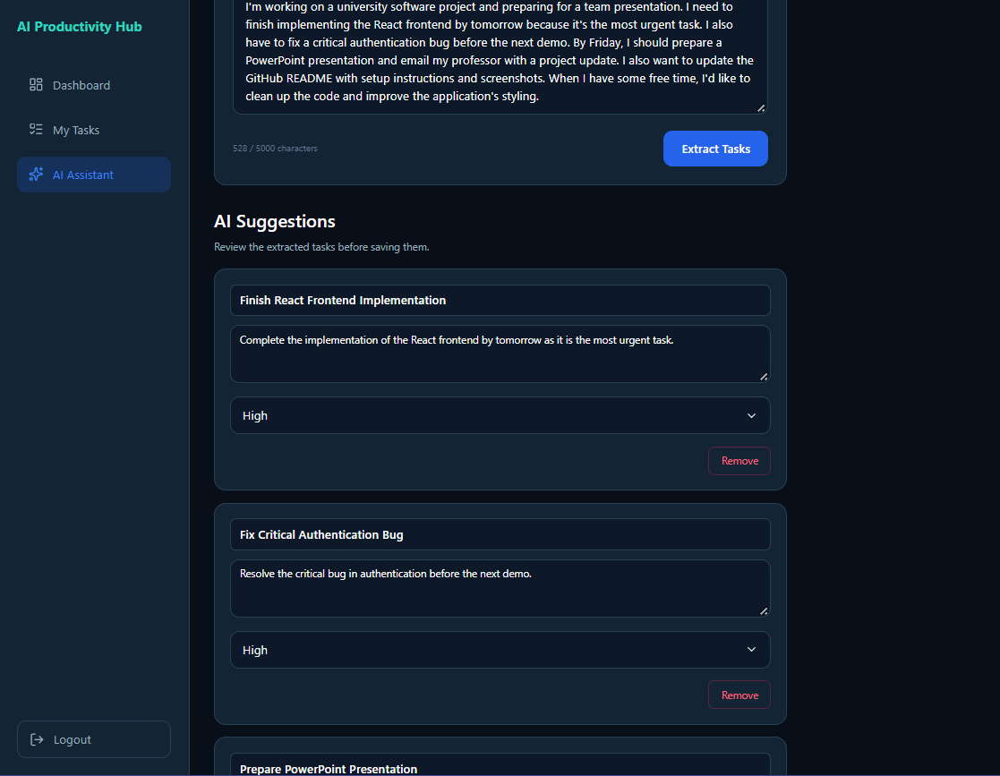
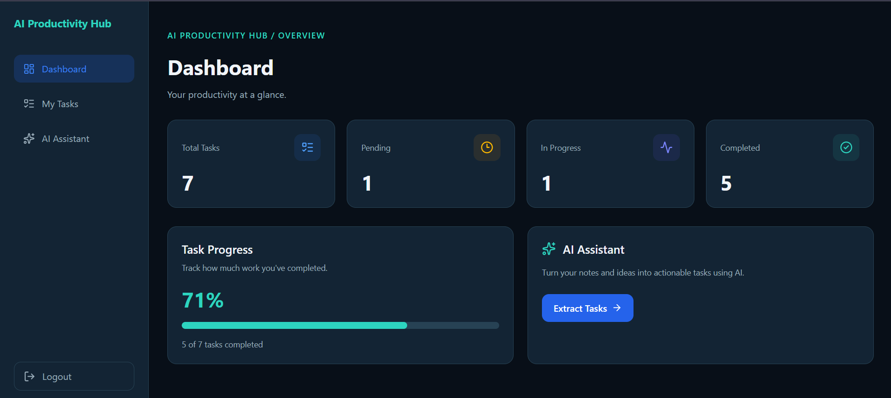
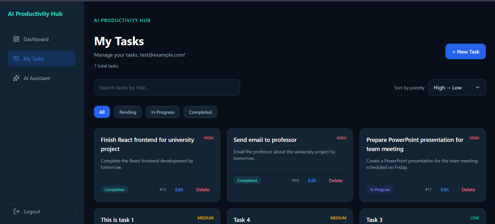

# AI Productivity Hub

A full-stack AI-powered productivity application that helps users manage tasks and transform natural-language notes into structured, actionable tasks using OpenAI's API.

## Tech Stack

**Backend:** Python, FastAPI, SQLAlchemy, Pydantic, PostgreSQL, Alembic  
**Frontend:** React, TypeScript, Tailwind CSS  
**AI Integration:** OpenAI API  
**Authentication:** JWT access tokens and rotating refresh tokens

## Features

- **AI Task Extraction:** Convert natural-language notes into structured task suggestions using an LLM.
- **Task Management:** Create, view, edit, and delete tasks with priorities and statuses.
- **AI Suggestion Review:** Edit or remove generated suggestions before saving them.
- **Dashboard:** Track task statistics and completion progress.
- **Search & Filtering:** Filter tasks by status, search by title, and sort by priority.
- **Secure Authentication:** User registration, login, logout, JWT authentication, and refresh token rotation.
- **User-Specific Data:** Each authenticated user can access their own tasks.

## Architecture

The application follows a client-server architecture:

- React and TypeScript provide the user interface.
- FastAPI exposes REST endpoints and integrates with OpenAI's API.
- Pydantic validates incoming data and AI-generated responses.
- SQLAlchemy manages database interactions with PostgreSQL.
- Alembic manages database schema migrations.

## Current Development

The application is actively being developed. Upcoming improvements include:

- Project-based task organization
- Drag-and-drop task management
- Additional automated tests
- Deployment

## Screenshots

### AI Task Assistant

Extract structured tasks from natural-language notes using OpenAI's API. Review and edit AI-generated suggestions before saving them.

### Dashboard

Monitor task statistics and track overall completion progress.

### Task Management

Create, edit, delete, search, filter, and prioritize tasks.

## Author

Developed as a personal project to gain practical experience in full-stack development, REST APIs, authentication, and LLM-powered applications.
